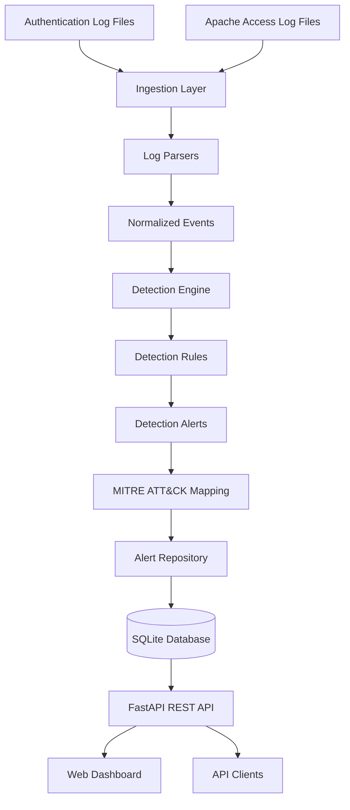

# Threat Detection Platform

A rule-based cybersecurity Threat Detection Platform built with Python and FastAPI.

The platform ingests Linux authentication logs (`auth.log`) and Apache access logs (`access.log`), parses and normalizes security events, applies eight detection rules, enriches generated alerts with MITRE ATT&CK techniques and tactics, persists alerts in SQLite, and exposes the results through a REST API and a web dashboard.

The project demonstrates practical detection-engineering concepts including:

- Security log ingestion
- Log parsing
- Event normalization
- Rule-based threat detection
- Threshold and time-window detection
- Signature-based web attack detection
- MITRE ATT&CK enrichment
- Alert persistence
- Alert filtering and pagination
- REST API development
- Web-based alert investigation
- Docker deployment
- Automated testing

**Project scope (fixed by design):** 2 log sources (Linux `auth.log` and Apache `access.log`) and 8 detection rules. The scope is deliberately limited so the project can be built properly rather than broadly and shallowly.

---

## Table of Contents

- [Overview](#overview)
- [Key Features](#key-features)
- [Architecture](#architecture)
- [Detection Rules](#detection-rules)
- [MITRE ATT&CK Mapping](#mitre-attck-mapping)
- [Technology Stack](#technology-stack)
- [Project Structure](#project-structure)
- [Quick Start with Docker](#quick-start-with-docker)
- [Verify the Application](#verify-the-application)
- [Sample Datasets](#sample-datasets)
- [Dashboard](#dashboard)
- [API Usage](#api-usage)
- [Log Ingestion](#log-ingestion)
- [CLI Usage](#cli-usage)
- [Local Python Development](#local-python-development)
- [Testing](#testing)
- [Evaluation Results](#evaluation-results)
- [Performance Evaluation](#performance-evaluation)
- [Documentation](#documentation)
- [Demo Walkthrough](#demo-walkthrough)
- [Limitations](#limitations)
- [Future Development](#future-development)
- [License](#license)

---

## Overview

Security logs contain valuable information about authentication attempts, privilege escalation, account changes, web requests, and potential attacks. However, raw log files are difficult to investigate directly and require structured processing before suspicious activity can be identified.

This project implements a complete detection pipeline that transforms raw log files into structured security events and evaluates those events using independently testable detection rules.

```
Raw Log Files
      ↓
Log Ingestion
      ↓
Log Parsing
      ↓
Event Normalization
      ↓
Detection Engine
      ↓
Detection Rules
      ↓
Alert Generation
      ↓
MITRE ATT&CK Enrichment
      ↓
Alert Repository
      ↓
SQLite Database
      ↓
FastAPI REST API
      ↓
Web Dashboard
```

The detection, parsing and MITRE mapping all happen in the backend. The dashboard only displays the results returned by the API.

The project is designed as a detection-engineering and cybersecurity portfolio project rather than a full production SIEM.

---

## Key Features

### Log Processing

- Linux authentication log parsing
- Apache combined access-log parsing
- Streaming log readers
- Syslog timestamp handling
- Apache timestamp parsing with timezone support
- Query-string extraction
- User-Agent extraction
- Referer extraction
- Malformed-input handling

### Detection

The platform implements eight detection rules:

1. SSH Brute Force
2. Successful Authentication After Failures
3. Excessive Sudo
4. New User Creation
5. Directory Scanning
6. SQL Injection
7. Cross-Site Scripting (XSS)
8. Suspicious User Agent

### Alert Management

- Alert generation
- Alert persistence
- Alert lookup by ID
- Alert filtering (rule, technique, source IP, tactic)
- Combined filters
- Date-range filtering
- Pagination
- Alert statistics
- MITRE ATT&CK enrichment

### API and Dashboard

- FastAPI REST API
- Interactive OpenAPI documentation
- File-upload ingestion endpoint
- Alert listing and retrieval
- Statistics endpoint
- Web dashboard with summary cards, charts, filters and alert detail view
- Error and empty-state handling

### Deployment and Quality

- Docker support
- Docker Compose deployment
- Persistent SQLite storage
- Automated test suite
- 95% code coverage
- Ruff linting
- End-to-end Docker validation

---

# Architecture

The architecture is intentionally modular so that log processing, normalization, detection, persistence, and presentation remain separated.



## Architecture Components

### 1. Ingestion Layer

Receives raw authentication and access log files and passes them into the appropriate processing pipeline.

### 2. Log Parsers

Parsers convert raw log lines into structured authentication or access events.

Supported inputs:

- Linux authentication logs
- Apache combined access logs

### 3. Normalization

Different log formats are transformed into a common normalized-event representation, so detection rules operate on a consistent event structure.

### 4. Detection Engine

The detection engine evaluates normalized events against the configured detection rules. Rules can use:

- Event conditions
- Thresholds
- Sliding time windows
- Pattern matching
- Indicator matching

If one rule fails, the engine logs the error and continues running the remaining rules.

### 5. MITRE ATT&CK Mapping

When a rule generates an alert, the platform enriches it with the corresponding MITRE ATT&CK technique and tactic.

### 6. Alert Repository

The repository layer provides database operations for saving, retrieving, listing, filtering and paginating alerts, and for alert statistics.

### 7. SQLite Database

Generated alerts are stored persistently using SQLite and SQLAlchemy. Docker Compose uses a named volume (`threat_detection_data`) so the database survives container restarts.

### 8. FastAPI API

FastAPI exposes the platform through REST endpoints for health checks, alert retrieval and filtering, alert statistics, and log ingestion.

### 9. Web Dashboard

The dashboard provides a browser-based interface for reviewing alerts, applying filters, viewing statistics, examining MITRE ATT&CK information, and investigating individual alerts.

---

# Detection Rules

| Rule                      | Log Type       | Detection Method                      | Severity |
| ------------------------- | -------------- | ------------------------------------- | -------- |
| SSH Brute Force           | Authentication | Failed-login threshold + time window  | High     |
| Successful After Failures | Authentication | Failed-login threshold before success | High     |
| Excessive Sudo            | Authentication | Threshold + time window               | High     |
| New User Creation         | Authentication | Event-based detection                 | High     |
| Directory Scanning        | Access         | Path count + 404 ratio + time window  | High     |
| SQL Injection             | Access         | Pattern matching                      | High     |
| XSS Attempt               | Access         | Pattern matching                      | High     |
| Suspicious User Agent     | Access         | Indicator matching                    | Low      |

Default thresholds:

| Rule                      | Threshold                                              |
| ------------------------- | ------------------------------------------------------ |
| SSH Brute Force           | 5 failed logins from one IP within 5 minutes           |
| Successful After Failures | 3 failed logins, then a success, within 5 minutes      |
| Excessive Sudo            | 10 sudo commands or 3 sudo failures within 5 minutes   |
| New User Creation         | Every user-added event                                 |
| Directory Scanning        | 15 distinct paths with at least 80% 404 in 5 minutes   |

Detailed detection logic, severities, and MITRE ATT&CK mappings are documented in
[`docs/final_report/detection_rules.md`](docs/final_report/detection_rules.md).

---

# MITRE ATT&CK Mapping

| Detection Rule            | Technique                                 | Tactic               |
| ------------------------- | ----------------------------------------- | -------------------- |
| SSH Brute Force           | T1110 — Brute Force                       | Credential Access    |
| Successful After Failures | T1110 — Brute Force                       | Credential Access    |
| Excessive Sudo            | T1548.003 — Sudo and Sudo Caching         | Privilege Escalation |
| New User Creation         | T1136.001 — Local Account                 | Persistence          |
| Directory Scanning        | T1595.003 — Wordlist Scanning             | Reconnaissance       |
| SQL Injection             | T1190 — Exploit Public-Facing Application | Initial Access       |
| XSS Attempt               | T1189 — Drive-by Compromise               | Initial Access       |
| Suspicious User Agent     | T1595.002 — Vulnerability Scanning        | Reconnaissance       |

> **Note on XSS:** MITRE ATT&CK has no dedicated cross-site scripting technique. T1189 (Drive-by Compromise) is used as the closest match, because the victim's browser is compromised through a web page.

More detail: [`docs/mitre_mapping_table.md`](docs/mitre_mapping_table.md).

---

# Technology Stack

| Component            | Technology                   |
| -------------------- | ---------------------------- |
| Programming Language | Python 3.12                  |
| API Framework        | FastAPI                      |
| ASGI Server          | Uvicorn                      |
| Database             | SQLite                       |
| ORM                  | SQLAlchemy                   |
| Frontend             | HTML, CSS, JavaScript        |
| UI Framework         | Bootstrap 5                  |
| Charts               | Chart.js                     |
| Detection Engine     | Custom Python implementation |
| Threat Framework     | MITRE ATT&CK                 |
| Containerization     | Docker                       |
| Orchestration        | Docker Compose               |
| Testing              | pytest                       |
| Linting              | Ruff                         |

**Why SQLite:** the platform has one writer (the ingest endpoint), a small data volume, and a demo that must be easy to run and reset. It needs no separate database server. Because the project uses SQLAlchemy, moving to PostgreSQL or MySQL later is mainly a change to `DATABASE_URL`.

---

# Project Structure

```
threat-detection-platform/
│
├── app/
│   ├── api/
│   │   ├── main.py
│   │   └── routers/
│   │       ├── alerts.py
│   │       ├── ingest.py
│   │       └── stats.py
│   │
│   ├── detection/
│   │   ├── engine.py
│   │   ├── rule_base.py
│   │   └── rules/
│   │       ├── directory_scanning.py
│   │       ├── excessive_sudo.py
│   │       ├── new_user_creation.py
│   │       ├── sql_injection.py
│   │       ├── ssh_brute_force.py
│   │       ├── successful_after_failures.py
│   │       ├── suspicious_user_agent.py
│   │       └── xss_attempt.py
│   │
│   ├── mitre/
│   │   └── mapping.py
│   │
│   ├── models/
│   │   ├── access_event.py
│   │   ├── alert.py
│   │   ├── auth_event.py
│   │   ├── database.py
│   │   ├── db_alert.py
│   │   └── normalized_event.py
│   │
│   ├── parsers/
│   │   ├── access_log_reader.py
│   │   ├── apache_parser.py
│   │   ├── auth_log_reader.py
│   │   ├── cli_access_reader.py
│   │   ├── cli_auth_reader.py
│   │   ├── linux_parser.py
│   │   └── timestamp_utils.py
│   │
│   ├── repository/
│   │   └── alert_repository.py
│   │
│   └── services/
│       ├── detection_engine.py
│       ├── ingestion.py
│       └── normalizer.py
│
├── data/
│   └── sample_logs/
│       ├── access_sample.log      # original sample (200 lines), used by the tests
│       ├── auth_sample.log        # original sample (200 lines), used by the tests
│       ├── access_demo.log        # demo dataset (300 lines, triggers all 4 web rules)
│       └── auth_demo.log          # demo dataset (300 lines, triggers all 4 authentication rules)
│
├── docs/
│   ├── final_report/
│   ├── database_schema_design.md
│   ├── detection_engine_design.md
│   ├── mitre_mapping_table.md
│   ├── performance_notes.md
│   └── testing.md
│
├── scripts/
│   ├── ingest.py
│   ├── init_db.py
│   ├── mitre_pipeline_dry_run.py
│   └── run_ingestion.py
│
├── static/
│   ├── dashboard.html             # page structure
│   ├── dashboard.css              # styles
│   └── dashboard.js               # fetches /alerts/ and /stats/, charts, table, filters
│
├── tests/
│
├── Dockerfile
├── docker-compose.yml
├── requirements.txt
└── README.md
```

---

# Quick Start with Docker

Docker Compose is the recommended way to run the complete application.

## Prerequisites

- Git
- Docker
- Docker Compose

```
docker --version
docker compose version
```

## 1. Clone the Repository

```
git clone https://github.com/sakoleat-kh/threat-detection-platform.git
cd threat-detection-platform
```

## 2. Build and Start the Application

```
docker compose up --build -d
docker compose ps
```

The application is available at `http://localhost:8000`.

## 3. Check Application Health

```
curl http://localhost:8000/health
```

Expected: `{"status":"ok"}`

## 4. Open the Dashboard

```
http://localhost:8000/static/dashboard.html
```

## 5. Open API Documentation

```
http://localhost:8000/docs
```

## 6. Stop the Application

```
docker compose down
```

The SQLite database is stored in the named Docker volume `threat_detection_data`, so it persists across normal container restarts.

To remove the containers **and** the database volume (a clean reset):

```
docker compose down -v
```

> **Warning:** `docker compose down -v` permanently deletes the volume containing the SQLite database.

---

# Verify the Application

```
curl http://localhost:8000/health
curl http://localhost:8000/alerts/
curl http://localhost:8000/stats/
```

The statistics response contains alert counts grouped by detection rule, MITRE technique and MITRE tactic.

---

# Sample Datasets

| File | Lines | Purpose |
| --- | --- | --- |
| `data/sample_logs/auth_sample.log` | 200 | Original authentication sample, used by the automated tests |
| `data/sample_logs/access_sample.log` | 200 | Original access sample, used by the automated tests |
| `data/sample_logs/auth_demo.log` | 300 | Demo dataset that triggers all 4 authentication rules |
| `data/sample_logs/access_demo.log` | 300 | Demo dataset that triggers all 4 web rules |

**Where the data comes from**

| Data | Source |
| --- | --- |
| Linux authentication log (real) | Elastic `examples` repository: [`suspicious_login_activity/data/auth.log`](https://github.com/elastic/examples/blob/master/Machine%20Learning/Security%20Analytics%20Recipes/suspicious_login_activity/data/auth.log) (7,121 lines; the repository was archived in January 2025) |
| Apache web access log, normal traffic (real) | Kaggle dataset [Web Server Access Logs](https://www.kaggle.com/datasets/eliasdabbas/web-server-access-logs) by Elias Dabbas |
| Attack lines in the access demo log | **Synthetic.** Written for this project, using reserved documentation IP ranges (`198.51.100.0/24`, `203.0.113.0/24`, `192.0.2.0/24`) |

**How the demo datasets were built**

- `auth_demo.log` consists of real line slices from the Elastic `auth.log`, kept in their original order.
- `access_demo.log` combines normal web traffic from the Kaggle access log with the synthetic attack lines above (directory scanning, SQL injection, XSS and scanner User-Agents), so that all four web rules can be demonstrated.

The full Elastic `auth.log` can also be ingested as it is. It contains about 56 real alerts (44 SSH brute-force sources, 1 login after failures, 1 excessive sudo, 10 new users). Please check each source's licence and terms before redistributing copies of the data; if in doubt, link to the originals instead of committing them.

**Expected result after ingesting both demo datasets once into an empty database**

| Rule | Alerts |
| --- | --- |
| `ssh_brute_force` | 2 |
| `successful_after_failures` | 1 |
| `excessive_sudo` | 1 |
| `new_user_creation` | 6 |
| `directory_scanning` | 1 |
| `sql_injection` | 8 |
| `xss_attempt` | 6 |
| `suspicious_user_agent` | 7 |
| **Total** | **32** |

These alerts cover 7 MITRE techniques and 5 tactics (Credential Access 3, Initial Access 14, Persistence 6, Privilege Escalation 1, Reconnaissance 8).

---

# Dashboard

The dashboard (`static/dashboard.html`, `dashboard.css`, `dashboard.js`) is a thin viewer. It never performs detection; it displays what the API returns. Its only write action is the upload card, which sends a log file to `POST /ingest/`.

```
FastAPI API → JSON → JavaScript → Dashboard
```

It provides:

- **Upload card:** choose a log file, log type, an optional rule and an optional maximum number of new alerts, then click **Upload**. The dashboard shows how many alerts were found and how many were saved, and refreshes itself
- **Summary cards:** total alerts, detection rules, MITRE techniques detected
- **Alerts by Detection Rule:** a chart of all 8 rules, showing 0 for rules without alerts
- **Alerts by MITRE Tactic:** a chart built from `GET /stats/`
- **Filters:** rule, tactic, start date and end date, sent to `GET /alerts/` as query parameters when **Apply Filters** is clicked
- **Recent alerts table:** ID, rule, severity, MITRE technique, tactic, source and user
- **Alert detail window:** full alert from `GET /alerts/{id}`, including the raw event JSON
- **Refresh button:** reloads statistics and alerts without a page reload
- **Empty and error states:** "No alerts found." and "Failed to load dashboard data."

Severity badges: critical or high is red, medium is yellow, low is gray.

Open the dashboard at:

```
http://localhost:8000/static/dashboard.html
```

The page loads Bootstrap and Chart.js from a CDN, so it needs internet access.

---

# API Usage

| Endpoint | Purpose |
| --- | --- |
| `GET /health` | Health check |
| `GET /alerts/` | List alerts (filters and pagination) |
| `GET /alerts/{id}` | One alert, including the raw event |
| `GET /stats/` | Counts by rule, technique and tactic |
| `POST /ingest/` | Upload a log file |

## Examples

```
curl http://localhost:8000/alerts/
curl http://localhost:8000/alerts/1
curl http://localhost:8000/stats/
curl "http://localhost:8000/alerts/?rule_id=excessive_sudo"
curl "http://localhost:8000/alerts/?technique_id=T1548.003"
curl "http://localhost:8000/alerts/?source_ip=198.51.100.23"
curl "http://localhost:8000/alerts/?tactic=Reconnaissance"
curl "http://localhost:8000/alerts/?start_date=2026-03-01&end_date=2026-04-30"
curl "http://localhost:8000/alerts/?limit=10&offset=0"
```

`limit` accepts 1 to 100 (default 20). Interactive documentation: `http://localhost:8000/docs`.

---

# Log Ingestion

The API provides a file-upload endpoint:

```
POST /ingest/
```

Required form fields: `file` and `log_type` (`auth` or `access`).

Uploaded files are processed from a temporary file and deleted afterwards. Only the generated alerts are stored, not the raw log files.

## Authentication Log

```
curl -X POST \
  -F "file=@data/sample_logs/auth_demo.log" \
  -F "log_type=auth" \
  http://localhost:8000/ingest/
```

Expected response for the demo dataset:

```
{"lines_processed": 300, "alerts_generated": 10, "alerts_saved": 10}
```

## Apache Access Log

```
curl -X POST \
  -F "file=@data/sample_logs/access_demo.log" \
  -F "log_type=access" \
  http://localhost:8000/ingest/
```

Expected response for the demo dataset:

```
{"lines_processed": 300, "alerts_generated": 22, "alerts_saved": 22}
```

> **Upload each file once.** Uploading the same file again stores its alerts again, which creates duplicates (see [Limitations](#limitations)).

After ingestion, view the alerts at `http://localhost:8000/static/dashboard.html`, or with `curl http://localhost:8000/alerts/`.

You can also upload through the browser at `http://localhost:8000/docs` using **POST /ingest/ → Try it out**.

---

## Adding Alerts One at a Time

`POST /ingest/` accepts two optional form fields:

| Field | Meaning |
| --- | --- |
| `max_alerts` | Save at most this many new alerts per upload (1 or more). Empty means no limit |
| `rule` | Save only alerts from one detection rule (a dropdown in `/docs`). Default: `all` |

Alerts that already exist are skipped, so uploading the same file twice does not create duplicates. With `max_alerts=1`, every upload of the same file saves the next alert that is not stored yet. With `rule=ssh_brute_force`, only SSH brute-force alerts are saved:

```
curl -X POST \
  -F "file=@data/sample_logs/auth_demo.log" \
  -F "log_type=auth" \
  -F "rule=ssh_brute_force" \
  -F "max_alerts=1" \
  http://localhost:8000/ingest/
```

A rule works only with the matching log type (authentication rules with `auth` logs, web rules with `access` logs).

The response shows `lines_processed`, `alerts_generated` (alerts found for the selected rule) and `alerts_saved` (new alerts stored this time). When `alerts_saved` is 0, every alert in the file is already stored.

---

# CLI Usage

## Ingest Authentication and Access Logs

```
python -m scripts.ingest \
  --auth-log data/sample_logs/auth_demo.log \
  --access-log data/sample_logs/access_demo.log
```

## Ingest Only Authentication Logs

```
python -m scripts.ingest --auth-log data/sample_logs/auth_demo.log
```

## Ingest Only Access Logs

```
python -m scripts.ingest --access-log data/sample_logs/access_demo.log
```

The CLI reports events processed, alerts generated and saved, parsing and normalization time, detection and MITRE enrichment time, database persistence time, and total runtime.

---

# Local Python Development

Docker Compose is recommended for running the application. For development and testing, the project can also run directly with Python.

## Prerequisites

- Python 3.12
- pip
- Git

## 1. Create a Virtual Environment

### Linux/macOS

```
python3.12 -m venv venv
source venv/bin/activate
```

### Windows

```
python -m venv venv
venv\Scripts\activate
```

## 2. Install Dependencies

```
pip install -r requirements.txt
```

## 3. Initialize the Database

```
python -m scripts.init_db
```

## 4. Start the API

```
uvicorn app.api.main:app --reload
```

- API: `http://localhost:8000`
- Documentation: `http://localhost:8000/docs`
- Dashboard: `http://localhost:8000/static/dashboard.html`

By default the local run stores alerts in `alerts.db` in the project folder. Docker uses `/app/data/alerts.db` inside its own volume. **The two databases are separate**, and only one server should run on port 8000 at a time.

---

# Testing

The project includes automated tests covering log parsers and readers, event normalization, detection rules, the detection engine, MITRE mapping, database functionality, the alert repository and filtering, API endpoints, and integration workflows.

## Run the Full Test Suite

```
python -m pytest -q
```

Result: `189 passed`

## Run Ruff

```
ruff check app scripts tests
```

Result: `All checks passed!`

## Test Coverage

```
95% overall coverage (741 statements, 39 missed)
```

The remaining uncovered code consists mainly of intentional abstract behavior and thin CLI wrapper code. More information: [`docs/testing.md`](docs/testing.md).

---

# Evaluation Results

The platform was evaluated using automated testing, representative log samples, API validation, dashboard testing, and Docker end-to-end testing.

## Automated Testing

```
189 tests passed
1 known dependency warning
95% overall coverage
```

## Original Sample Logs

```
auth_sample.log:   200 lines processed, 1 alert generated
access_sample.log: 200 lines processed, 0 alerts generated
```

The original samples contain only one detectable behavior (excessive sudo), so they exercise one of the eight rules. The automated tests use them as fixed test data.

## Demo Datasets (All Eight Rules)

```
auth_demo.log:   300 lines processed, 10 alerts generated
access_demo.log: 300 lines processed, 22 alerts generated
Total: 32 alerts, 8 of 8 rules triggered, 7 MITRE techniques, 5 tactics
```

These results were confirmed through the API (`GET /stats/`) and the dashboard in Docker.

## MITRE Detection Pipeline

The MITRE pipeline dry run processed 400 normalized events and generated 1 alert, associated with T1548.003 — Sudo and Sudo Caching (Privilege Escalation).

## Docker Validation

The Docker deployment was tested for image build, container startup, API health, authentication and access log ingestion, alert retrieval, alert statistics, and database persistence. Alerts remained available after stopping and restarting Docker Compose, confirming persistent SQLite storage through the named volume.

More detail: [`docs/final_report/results.md`](docs/final_report/results.md).

---

# Performance Evaluation

A performance evaluation was run using synthetic log data generated from the project's sample logs. The benchmark processed 10,348 input lines (5,174 authentication and 5,174 access lines). Measured stages were parse and normalization, detection and MITRE enrichment, database persistence, and total runtime.

The evaluation demonstrates the behavior of the current implementation under the tested workload. It is not a claim of production-scale performance. Details: [`docs/performance_notes.md`](docs/performance_notes.md).

---

# Documentation

Additional technical documentation is available under [`docs/`](docs).

## Final Report

- [`introduction.md`](docs/final_report/introduction.md) — motivation, scope, and report organization
- [`architecture.md`](docs/final_report/architecture.md) — detailed system architecture
- [`detection_rules.md`](docs/final_report/detection_rules.md) — detection logic, thresholds, severity, and MITRE mappings
- [`results.md`](docs/final_report/results.md) — evaluation results and limitations

## Technical Documentation

- [`testing.md`](docs/testing.md) — testing strategy and coverage
- [`performance_notes.md`](docs/performance_notes.md) — performance evaluation
- [`database_schema_design.md`](docs/database_schema_design.md) — database design
- [`detection_engine_design.md`](docs/detection_engine_design.md) — detection engine design
- [`mitre_mapping_table.md`](docs/mitre_mapping_table.md) — MITRE ATT&CK mappings
- [`normalized_event_design.md`](docs/normalized_event_design.md) — normalized event design
- [`auth_event_design.md`](docs/auth_event_design.md) — authentication event design
- [`access_event_design.md`](docs/access_event_design.md) — access event design

---

# Demo Walkthrough

A step-by-step demonstration, starting from an empty database:

1. Start a clean system:
   ```
   docker compose down -v
   docker compose up --build -d
   ```
2. Show the empty state: `curl http://localhost:8000/stats/` returns empty groups.
3. Open `http://localhost:8000/docs` and upload `auth_demo.log` with `log_type=auth` (10 alerts).
4. Upload `access_demo.log` with `log_type=access` (22 alerts).
5. Open the dashboard and show 32 alerts, 8 of 8 rules, 7 techniques and 5 tactics.
6. Show the **Alerts by Detection Rule** and **Alerts by MITRE Tactic** charts.
7. Filter by rule (for example `sql_injection`) and click **Apply Filters**.
8. Click an alert to open its detail window, including the MITRE technique and raw event JSON.
9. Show the same data through the API (`/alerts/` and `/stats/`).

The demo datasets have dates without a year (authentication) and from January 2019 (access), so leave the date filters empty.

---

# Limitations

This project demonstrates a focused rule-based threat detection workflow and should not be considered a complete production SIEM.

## Supported Log Sources

The scope is fixed to Linux authentication logs and Apache combined access logs. It does not provide enterprise-wide log collection.

## Rule-Based Detection

Detection relies on predefined thresholds, time windows, conditions, signatures, and indicators. The platform does not implement machine-learning anomaly detection or adaptive behavioral baselines.

## Detection Limitations

Signature- and threshold-based detection can produce false positives or false negatives depending on the input data and attack variations. The rules would need tuning and evaluation on larger, more diverse datasets. In particular:

- The web attack rules match patterns in the request path and query string. URL-encoded payloads are detected only if the parser decodes them.
- The SQL injection comment patterns (`--`, `#`) are broad and can match harmless requests.
- Successful-after-failures does not exclude loopback addresses.
- The suspicious User-Agent rule matches tool names as substrings.

## Ingestion Limitations

- Ingestion is not idempotent: uploading the same log file twice stores its alerts twice.
- Each upload is analysed on its own. Detection windows do not span separate uploads.
- Authentication logs carry no year, so the year is inferred from the upload date.

## Performance Limitations

The project has not been benchmarked for enterprise-scale throughput, high-concurrency ingestion, production latency, distributed deployment, or long-term memory usage.

## Production Security Operations

The platform does not provide the capabilities of a production SIEM/SOC platform, such as large-scale distributed log collection, cross-source correlation, automated incident response, alert lifecycle management, **authentication and authorization on the API**, or high-availability deployment.

---

# Future Development

- Additional log-source support
- More advanced event correlation
- Larger and more diverse evaluation datasets
- Larger-scale performance benchmarking
- More sophisticated detection signatures and URL decoding
- Idempotent ingestion (skip duplicate alerts)
- Adaptive behavioral detection
- Improved alert lifecycle management
- Authentication and role-based access control
- Automated incident-response capabilities
- Production-oriented deployment, for example PostgreSQL

---

# License

This project is intended as a cybersecurity and detection-engineering project for educational, research, and portfolio purposes.